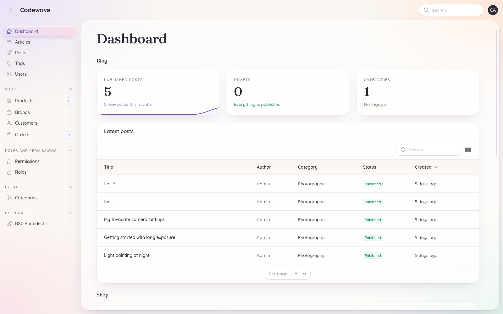
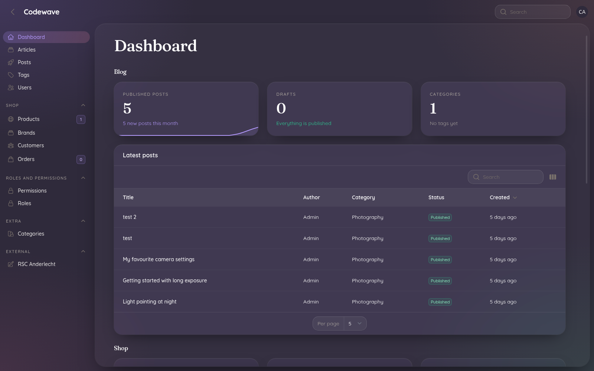
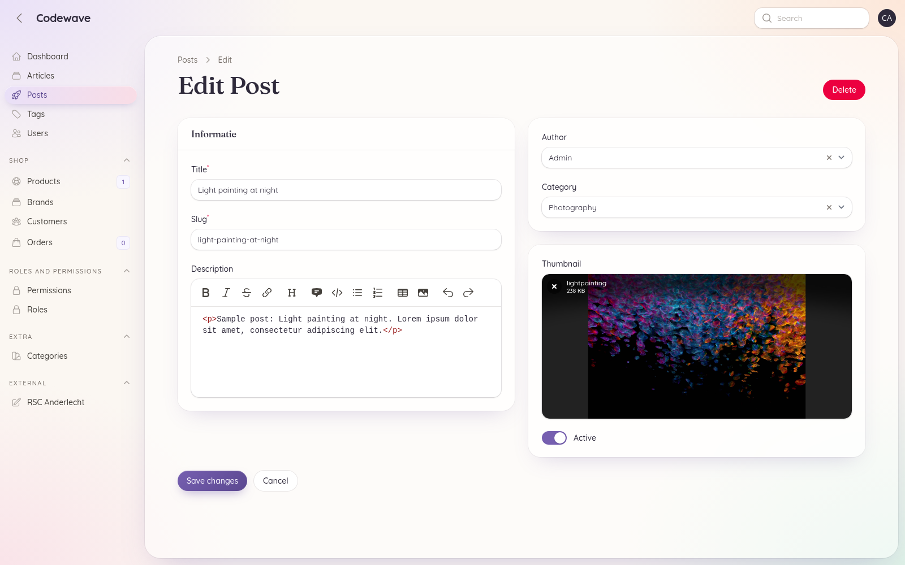
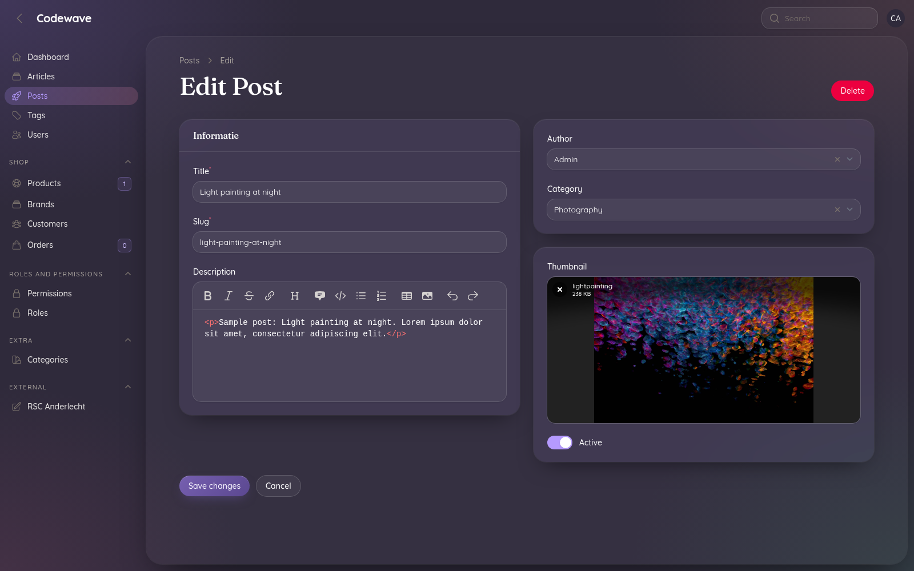

# Codewave blog: backend

Laravel 13 API and Filament admin panel for the blog. The Nuxt frontend in [`../frontend`](../frontend) reads posts from this API.

## Stack

- [Laravel 13](https://laravel.com/docs) on PHP 8.5
- [Filament 5](https://filamentphp.com/docs) admin panel at `/dashboard` (Livewire 4)
- `spatie/laravel-permission` (roles and permissions, managed through `althinect/filament-spatie-roles-permissions`)
- `spatie/laravel-medialibrary` for post images
- `pxlrbt/filament-excel` (Excel export) and `pxlrbt/filament-spotlight`
- Sanctum for API authentication
- Invitation-only users with `admin` and `editor` roles (see below)

## Requirements

- PHP 8.5 with the `intl`, `pdo_mysql`, `gd` and `zip` extensions
- Composer 2
- MySQL 8
- Mailpit (or another SMTP server) for the invitation emails

For a local MySQL in Docker:

```bash
docker run -d --name nlb-mysql -p 3306:3306 \
  -e MYSQL_ALLOW_EMPTY_PASSWORD=yes -e MYSQL_DATABASE=backend \
  -v nlb-mysql-data:/var/lib/mysql mysql:8.4
```

## Setup

```bash
composer install
cp .env.example .env
php artisan key:generate
php artisan migrate
php artisan storage:link
```

Set `APP_URL` to the URL you serve the app on (`http://localhost:8000` with `php artisan serve`); image URLs in the API are built from it.

Create the first admin. For an existing user this only adds the `admin` role; for a new email it creates the user and emails an invitation:

```bash
php artisan app:make-admin you@example.com --name="Your Name"
```

## Users and invitations

There is no public registration. Admins add users under **Users → New user** (name, email, role); the user gets an email with a one-time link (valid for 48 hours) to choose a password and is logged in right after. Pending invitations can be resent from the users list.

| Role | Access |
|---|---|
| `admin` | Everything: users, roles and permissions, shop (products, brands, customers, orders) and all dashboard widgets |
| `editor` | Blog content: posts, articles, tags, categories, and the blog widgets on the dashboard |

Users without one of these roles can't open the panel.

## Mail

Locally, mail goes to [Mailpit](https://mailpit.axllent.org) (SMTP on port 1025, inbox at `http://localhost:8025`):

```bash
docker run -d --name nlb-mailpit -p 1025:1025 -p 8025:8025 axllent/mailpit
```

In production, set the `MAIL_*` variables in `.env` to a real mail provider.

## Development

```bash
php artisan serve
```

- Admin panel: `http://localhost:8000/dashboard`
- API: `http://localhost:8000/api/v1/posts`, `/api/v1/posts/{slug}`, `/api/v1/products`, `/api/v1/products/{slug}`

## Tests

Tests run on an in-memory SQLite database, so they don't need MySQL:

```bash
php artisan test
```

## Admin panel

The admin panel uses the same pastel palette and fonts (Quicksand and Fraunces) as the Nuxt site. It has a light and a dark mode; it follows the system setting by default, and users can switch in the user menu.

### Dashboard

| Light | Dark |
|---|---|
|  |  |

- **Blog** (admins and editors): published posts with a 6-month trend, drafts, categories and tags, and the latest posts (click a row to edit it).
- **Shop** (admins only): customers, products and pending orders, orders by status, products added in the last 12 months, and the latest orders.

### Editing a post

| Light | Dark |
|---|---|
|  |  |

### Theme

- **Colors and font** are set in `app/Providers/Filament/AdminPanelProvider.php`.
- **Everything else** (background, glass cards, the content window, pill buttons, dropdowns, scrollbars) is plain CSS in `resources/css/filament/admin-theme.css`, so there is no npm build step.

After changing the CSS, publish it to `public/css/app/admin-theme.css`, which is the copy browsers load:

```bash
php artisan filament:assets
```

`composer update` runs this too.
