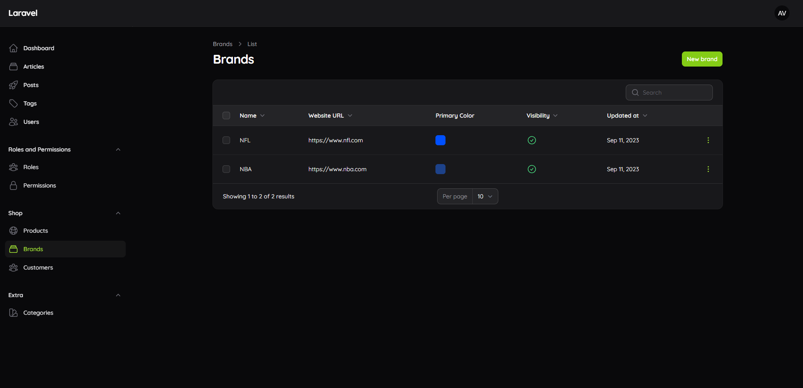
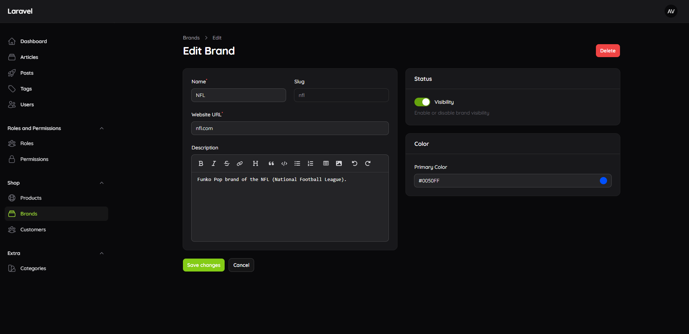

# Codewave blog: backend

Laravel 13 API and Filament admin panel for the blog. The Nuxt frontend in [`../frontend`](../frontend) reads posts from this API.

## Stack

- [Laravel 13](https://laravel.com/docs) on PHP 8.5
- [Filament 5](https://filamentphp.com/docs) admin panel at `/dashboard` (Livewire 4)
- `spatie/laravel-permission` (roles and permissions, managed through `althinect/filament-spatie-roles-permissions`)
- `spatie/laravel-medialibrary` for post images
- `pxlrbt/filament-excel` (Excel export) and `pxlrbt/filament-spotlight`
- Sanctum for API authentication

## Requirements

- PHP 8.5 with the `intl`, `pdo_mysql`, `gd` and `zip` extensions
- Composer 2
- MySQL 8

For a local MySQL in Docker:

```bash
docker run -d --name nlb-mysql -p 3306:3306 \
  -e MYSQL_ALLOW_EMPTY_PASSWORD=yes -e MYSQL_DATABASE=backend \
  -v nlb-mysql-data:/var/lib/mysql mysql:8.4
```

## Setup

```bash
composer install
cp .env.example .env
php artisan key:generate
php artisan migrate
php artisan storage:link
```

Set `APP_URL` to the URL you serve the app on (`http://localhost:8000` with `php artisan serve`); image URLs in the API are built from it.

There is no seeder yet. Create an admin user with:

```bash
php artisan tinker --execute 'App\Models\User::create(["name" => "Admin", "email" => "admin@example.com", "password" => "password"]);'
```

## Development

```bash
php artisan serve
```

- Admin panel: `http://localhost:8000/dashboard`
- API: `http://localhost:8000/api/v1/posts`, `/api/v1/posts/{slug}`, `/api/v1/products`, `/api/v1/products/{slug}`

## Tests

Tests run on an in-memory SQLite database, so they don't need MySQL:

```bash
php artisan test
```

## Some screenshots from my work with FilamentPHP



