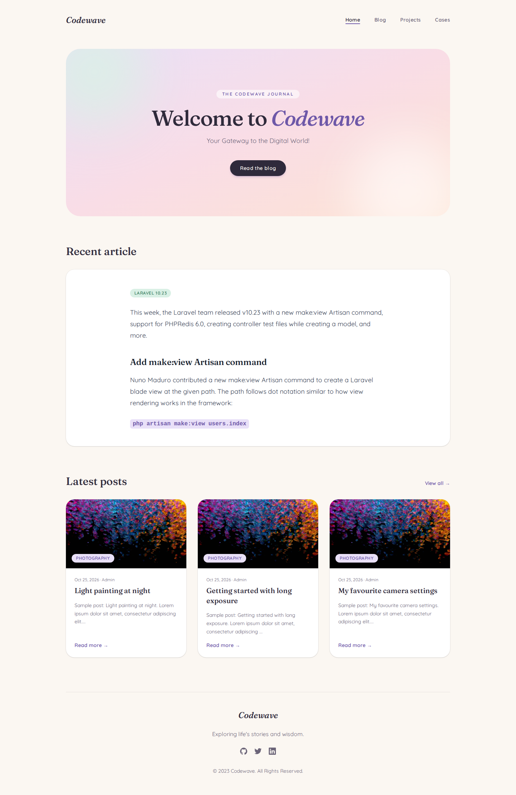

# Codewave blog: frontend

Nuxt 4 frontend for the blog. Posts come from the Laravel API in [`../backend`](../backend); markdown files in `content/` are handled by Nuxt Content.

## Stack

- [Nuxt 4](https://nuxt.com/docs) (Vue 3.5), source in `app/`
- [Nuxt Content 3](https://content.nuxt.com) for markdown in `content/`, collections in `content.config.ts`
- [Tailwind CSS 4](https://tailwindcss.com) via `@tailwindcss/vite`, configured in `app/assets/css/main.css`
- `@nuxt/image`, `@nuxt/icon`, Headless UI, Heroicons

## Requirements

- Node 22.5+ (Node 24 recommended, see `.nvmrc`). Nuxt Content uses Node's built-in SQLite.
- The backend API running (default `http://localhost:8000`)

## Setup

```bash
npm install
```

The API URL defaults to `http://localhost:8000/api/v1`. Override it with an environment variable or a `.env` file:

```bash
NUXT_PUBLIC_API_BASE=https://api.example.com/api/v1
```

## Development

Start the dev server on `http://localhost:3000`:

```bash
npm run dev
```

## Production

```bash
npm run build
npm run preview
```

See the [deployment documentation](https://nuxt.com/docs/getting-started/deployment) for hosting options.

## Homepage

Work in progress


