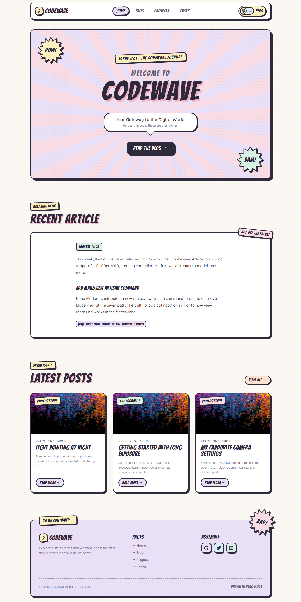
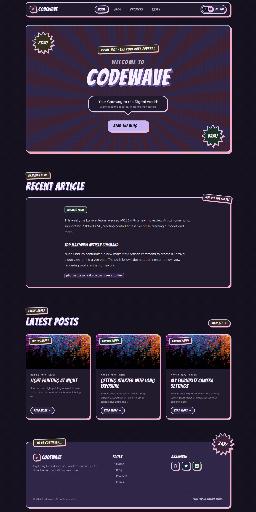
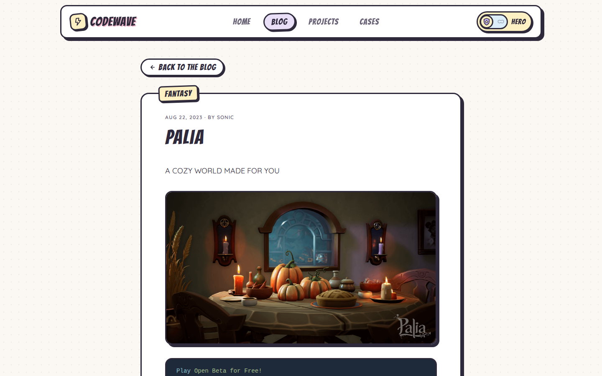
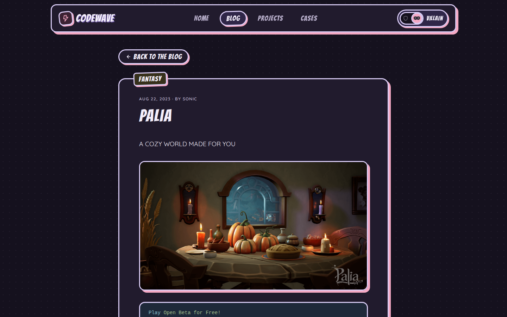
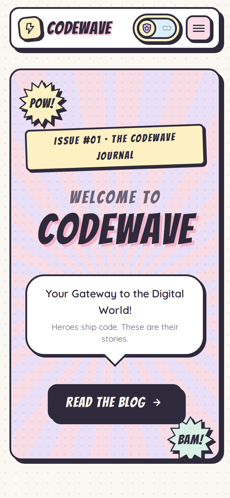
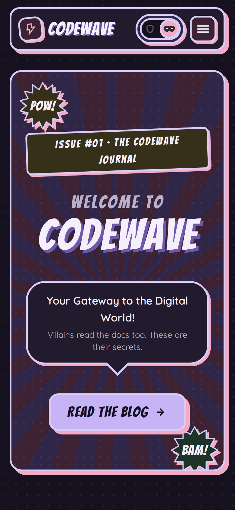

# Codewave blog: frontend

Nuxt 4 site for the Codewave blog. It shows posts from the Laravel API in [`../backend`](../backend) together with markdown posts from `content/blog`, in a comic-book style on a pastel palette, with a light ("hero") and a dark ("villain") mode.

| Hero (light) | Villain (dark) |
|---|---|
|  |  |
|  |  |
|  |  |

## Stack

- [Nuxt 4](https://nuxt.com/docs) (Vue 3.5), source in `app/`
- [Nuxt Content 3](https://content.nuxt.com) for markdown posts, collection defined in `content.config.ts`
- [Tailwind CSS 4](https://tailwindcss.com) via `@tailwindcss/vite`, with the typography plugin; theme in `app/assets/css/main.css`
- `@nuxtjs/color-mode` for the light/dark switch, `@nuxt/image` and `@nuxt/icon` (Unicons, `uil:*`)
- TypeScript checks with `vue-tsc`

## Requirements

- Node 22.5+ (Node 24 recommended, see `.nvmrc`). Nuxt Content uses Node's built-in SQLite.
- The backend API running (default `http://localhost:8000`). See the [root README](../README.md) for the full local setup.

## Setup

```bash
npm install
npm run dev        # http://localhost:3000
```

The API URL defaults to `http://localhost:8000/api/v1`. Override it with an environment variable or a `.env` file:

```bash
NUXT_PUBLIC_API_BASE=https://api.example.com/api/v1
```

Run the site on the origin set as `FRONTEND_URL` in `backend/.env` (`http://localhost:3000` by default). The API only allows CORS requests from that origin, so on another port the API posts won't load.

## Scripts

| Command | What it does |
|---|---|
| `npm run dev` | Dev server with hot reload on `http://localhost:3000` |
| `npm run build` | Production build in `.output/` |
| `npm run preview` | Serve the production build locally |
| `npm run typecheck` | Type check the app with `vue-tsc` |

CI (`.github/workflows/ci.yml`) runs `npm run typecheck` and `npx nuxt build` on every pull request and on pushes to `main`. See the [deployment documentation](https://nuxt.com/docs/getting-started/deployment) for hosting options.

## Pages

| Page | Shows |
|---|---|
| `/` | Hero, a featured article and the three latest posts |
| `/blog` | All posts, newest first |
| `/blog/<slug>` | One post |
| `/cookies` | Cookie policy: what the site stores, and a button to change cookie choices |
| `/privacy` | Privacy policy: what personal data the site handles, why, for how long, and visitors' rights |
| Any other path | The error page (`app/error.vue`), for example a 404 |

## Posts

`app/composables/useBlogPosts.js` loads both kinds of posts and merges them into one list, newest first:

- **API posts** come from `GET /api/v1/posts` and are loaded in the browser.
- **Markdown posts** are the files in `content/blog/*.md`, rendered on the server. They are converted to the API's shape so both render with the same `PostCard` component. Their images go in `public/images/blog/`.

On `/blog/<slug>`, a markdown post with that slug wins over an API post with the same slug. See [`backend/docs/Nuxt-Content.md`](../backend/docs/Nuxt-Content.md) for the frontmatter fields and the components you can use in markdown (such as `Callout`).

## Theme

### Colors

Every color is a CSS variable in `app/assets/css/main.css`. The `:root` block sets the light (hero) values and the `.dark` block sets the dark (villain) ones. Tailwind theme tokens point at these variables, so a utility like `bg-lavender` or `text-ink-soft` picks the right color in both modes and most markup needs no `dark:` variants.

| Token | Use |
|---|---|
| `paper`, `panel` | Page background and card surfaces |
| `ink`, `ink-soft` | Text and muted text |
| `line`, `pop` | Comic outlines and the hard offset shadows |
| `lavender`, `rose`, `peach`, `mint`, `lemon`, `sky` | Pastel tints for panels, badges and caption boxes |
| `lavender-deep`, `rose-deep`, `mint-deep` | Accent text on those tints |

Headings use Bangers (`font-comic`) and body text uses Quicksand (`font-quicksand`), both loaded from Bunny Fonts.

### Comic utilities

| Utility | What it does |
|---|---|
| `comic-panel` | Bordered panel with a hard offset shadow |
| `comic-title` | Big comic lettering with a pastel drop shadow |
| `comic-rays` | Radiating rays behind a splash panel; set the ray color with `[--ray:var(--rose)]` |
| `halftone` | Printed-comic dot pattern |
| `shadow-comic-sm`, `shadow-comic`, `shadow-comic-lg` | Hard offset shadows in three sizes |

### Light and dark mode

`@nuxtjs/color-mode` puts a `dark` class on `<html>`. It follows the system setting until a visitor uses the switch in the menu (`ThemeSwitch`), then remembers the choice in `localStorage` (`codewave-color-mode`).

### Animations

- `v-reveal` (`app/plugins/reveal.ts`) slides an element in once it scrolls into view: `v-reveal` (from below), `v-reveal="'left'"` (also `'right'`, `'down'`, `'pop'`), or `v-reveal="{ from: 'right', delay: 150 }"`.
- Pages slide in and out on navigation (`app.pageTransition` in `nuxt.config.ts`).
- Visitors with "reduce motion" turned on get no animations, and without JavaScript everything is shown straight away.

## Cookie consent

On a first visit, `CookieBanner` asks for cookie consent. It follows the GDPR and ePrivacy rules: "Reject all" is as visible as "Accept all", no option is pre-ticked, the site works without an answer, and **Cookie settings** in the footer (or on `/cookies`) changes the choice at any time. The choice is saved in the `codewave-consent` cookie for 6 months.

The site uses no statistics or marketing tools yet. To add one:

1. List it as a service under its category in `app/composables/useCookieConsent.ts`, with the cookies it sets. Withdrawing consent deletes those cookies and reloads the page.
2. Load it only when the visitor has said yes:

   ```ts
   const { allowed } = useCookieConsent()
   watchEffect(() => { if (allowed('analytics')) loadAnalytics() })
   ```

3. Add what it stores to the tables in `app/pages/cookies.vue`, and change the "last updated" date there.
4. Raise `CONSENT_VERSION`, so every visitor is asked again.

## Privacy policy

`/privacy` describes every way the site handles personal data, as the GDPR (article 13) requires. The facts the code can't know live in `app/utils/legal.ts`: who runs the site and how to reach them, the hosting and email providers, how long server logs are kept, and the data protection authority. Values in `[square brackets]` are placeholders; while any are left, the page shows a "draft" notice.

When the site starts handling personal data in a new way (a contact form, a tracker, a new provider), add it to the `purposes` or `recipients` list in `app/pages/privacy.vue` and change the "last updated" date there.

## Project structure

```
app/
  app.vue               Layout: navigation, page, footer
  error.vue             Error page (404 and others)
  assets/css/main.css   Tailwind setup, theme tokens for both modes, comic utilities, animations
  components/           Navigation, footer, logo, theme switch, cookie banner, post card, comic bursts and headings
  components/content/   Components for use inside markdown posts
  composables/          useBlogPosts, useCookieConsent
  pages/                index, blog/index, blog/[slug], cookies, privacy
  utils/legal.ts        Controller, providers and authority for the privacy policy
  plugins/reveal.ts     The v-reveal scroll animation
docs/screenshots/       Screenshots for this README
content/blog/           Markdown posts
public/images/blog/     Images for markdown posts
nuxt.config.ts          Modules, API base URL, content and image settings
content.config.ts       Frontmatter schema for the blog collection
```

## Not built yet

- The **Projects** and **Cases** links in the navigation have no pages yet; they show the 404 page.
- The featured article on the homepage is hard-coded in `app/pages/index.vue`.
